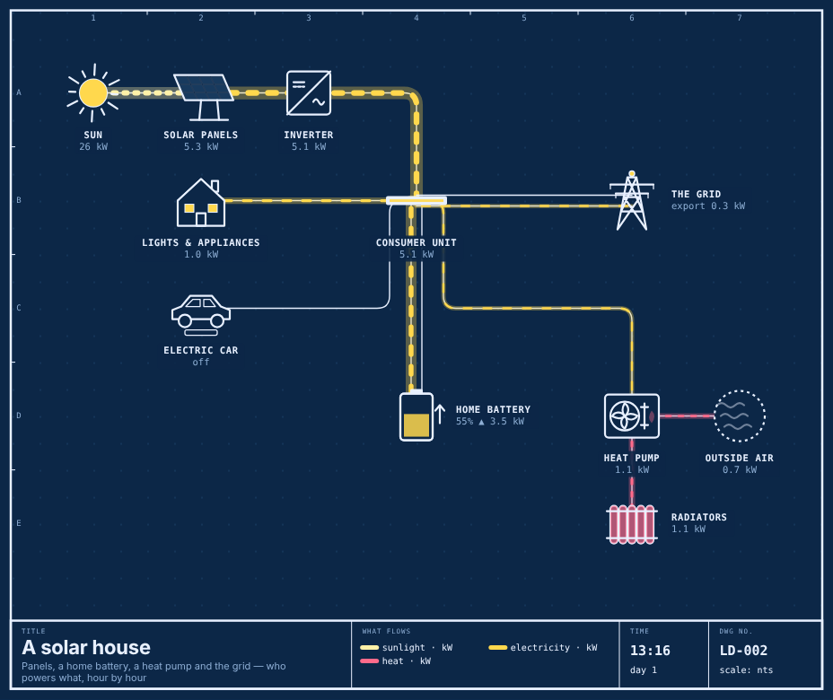

<!-- SPDX-License-Identifier: AGPL-3.0-only -->
<!-- SPDX-FileCopyrightText: 2026 Vaibhav Patel -->

# Anigram — living diagrams of real machines

**Engineering drawings that run.** A Rube Goldberg machine, drawn like a
Lucidchart: every wire, pipe and shaft on the sheet carries what the
simulation says it carries, at the speed it carries it. Trip a breaker and
the city goes dark while the hospital's diesel catches it. Open a hydrant and
watch the water tower drain. Push the clouds across a solar house and see the
battery give up and the grid take over.

Nothing is animated by hand. Line thickness is flow. Dash speed is flow. A
turbine spins as fast as it is generating; a window is lit when its building
is being served. If the drawing shows it, the system is doing it.

<p align="center"></p>

## Five sheets to start

| Sheet                          | What it shows                                                                                                                                                        | Poke it                                               |
| ------------------------------ | -------------------------------------------------------------------------------------------------------------------------------------------------------------------- | ----------------------------------------------------- |
| **LD-001 The power grid**      | gas, nuclear and wind feeding a city; pumped hydro storing night-time surplus for the evening peak; two thirds of a reactor's heat leaving through the cooling tower | trip the transmission breaker; change wind and demand |
| **LD-002 A solar house**       | panels → inverter → consumer unit; a battery that only fills from spare sun; a heat pump pulling free heat out of cold air; import and export                        | plug the car in; add cloud; make it colder            |
| **LD-003 A town's water**      | borehole pump, treatment, a water tower on a float switch, gravity doing the rest; leaks                                                                             | open the fire hydrant; grow the town                  |
| **LD-004 A hydroelectric dam** | rain into a reservoir, a turbine into a town, and the spillway in a storm                                                                                            | shut the intake gate; make it rain                    |
| **LD-005 A data centre**       | electricity in, requests and heat out; UPS batteries bridging the minutes a diesel needs to start                                                                    | trip the mains; push traffic past capacity            |

## One drawing, three media

- **On a website** — `?embed=1&scene=grid` is the sheet and a slim play bar,
  made for an iframe. The app's **embed** button writes the snippet.
- **On paper** — **paper** mode stops the clock and labels every flow with its
  value and direction, like a Sankey diagram drawn by an engineer. **print**
  fills a landscape page; **↓ svg** saves a self-contained vector file that
  opens the same in a browser, Figma or Illustrator.
- **On a screen** — `?screen=1` is a full-bleed blueprint with a big caption
  that tours every sheet, one simulated day each. Made for a wall.

<p align="center"></p>

## How it works

A **scene** is data: parts on a grid and the links between them
(`src/scenes/*.ts`). Each part has a behaviour — `source`, `sink`, `bus`,
`gate`, `converter`, `storage` or `vent` — and each link carries one domain:
light, electricity, water, heat, fuel, shaft power or requests.

Every tick, `src/sim/solver.ts` resolves the whole network as a **pull**. Each
demand asks upstream for what it wants; a busbar asks its cheapest input
first (renewables, then storage, then anything that burns fuel); a converter
asks for its recipe (a 45%-efficient gas plant takes 2.2 units of fuel per
unit of electricity) and sends what it loses down a loss link; a gate never
passes more than it is open. Stores then charge from surplus only — so a
battery fills from sun nobody used, never by burning gas — and whatever is
still unclaimed goes to export or over the spillway. A store answers a pull
but never forwards one, which is what lets a loop through storage (pump uphill
at night, generate at the peak) work without recursion.

The sheet (`src/view/Sheet.tsx`) re-renders from that state on a single
`requestAnimationFrame` clock. The ~40 part glyphs (`src/parts/glyphs.tsx`)
are plain SVG functions of the part's state: `fill` raises the water in a
tower, `activity` spins a turbine and lights windows, `starting` flags a
diesel set that hasn't caught yet.

```ts
// a fragment of LD-001: the hospital takes priority, and its diesel set waits behind the city busbar
{ id: 'hospital', kind: 'hospital', label: 'Hospital', at: [8, 2],
  behaviour: { role: 'sink', demand: 60, priority: 10 } },
{ id: 'diesel', kind: 'generator', label: 'Backup diesel', at: [9, 2],
  behaviour: { role: 'converter', output: 'electric', recipe: { fuel: 2.6 }, capacity: 70 } },
```

Run any scene headless through a day to check its story:

```sh
npm run simulate grid            # every part, hour by hour
npm run simulate grid lake,hydro # just these
```

## Embedding

The URL is the API:

| Param                    |                                                                                                                                |
| ------------------------ | ------------------------------------------------------------------------------------------------------------------------------ |
| `scene=<id>`             | `grid`, `solar-home`, `water-tower`, `hydro-dam`, `data-centre` (the old `cdn` / `microservices` / `oauth2` ids still resolve) |
| `embed=1`                | just the sheet and a play bar; `embed=presentation` is the same                                                                |
| `embed=app`              | the full app without its header                                                                                                |
| `screen=1`               | wall-screen tour                                                                                                               |
| `theme=paper\|blueprint` | the sheet's palette                                                                                                            |
| `mode=paper`             | frozen and labelled                                                                                                            |
| `t=18.5`                 | open at 18:30                                                                                                                  |
| `speed=4`                | clock multiplier                                                                                                               |

## Commands

```sh
npm install
npm run dev        # vite dev server
npm run build      # tsc -b && vite build → dist/
npm test           # the simulation's rules, in node's own test runner
npm run simulate   # a scene through a day, headless
npm run typecheck  # tsc -b
npm run lint       # oxlint
npm run format     # prettier --write .
```

## Layout

```
src/
  sim/      the rulebook — React-free, runs in node: types, solver, runtime clock, day curves
  scenes/   the five sheets, as data
  parts/    the glyph library: one SVG function per kind of part
  view/     the drawing sheet: geometry, palette, labels and flow tags, the title block
  app/      the workbench, embed and screen views, URL params, export
```

See [ROADMAP.md](ROADMAP.md) for where it goes next.

## License

Anigram is **dual-licensed**:

- **[AGPL-3.0-only](LICENSE)** — free for open-source and personal use. If you run
  a modified version over a network, you must offer users its source (AGPL §13).
- **[Commercial license](COMMERCIAL-LICENSE.md)** — for embedding in closed-source
  or commercial products without AGPL's copyleft/network-source obligations.

## Contributing

PRs welcome — see [CONTRIBUTING.md](CONTRIBUTING.md). A signed
**[CLA](CLA.md)** is required so the project can offer the commercial license.

## Trademarks

Anigram is an independent project. All icons and drawings shipped in this repo
are original works. See [NOTICE](NOTICE).
