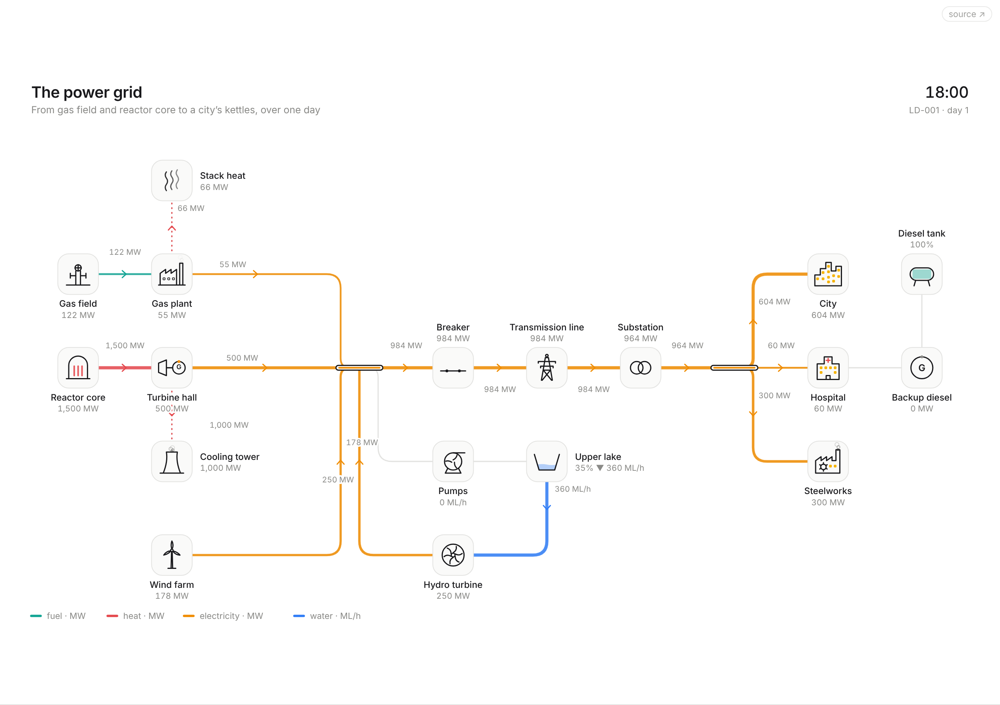
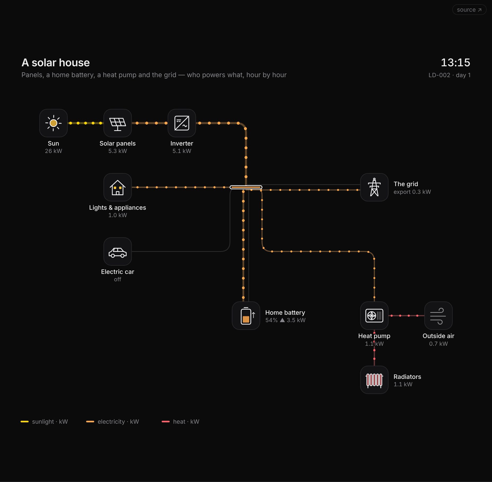

<!-- SPDX-License-Identifier: MIT -->
<!-- SPDX-FileCopyrightText: 2026 Vaibhav Patel -->

# Anigram — living diagrams of real machines

**Engineering drawings that run.** A Rube Goldberg machine, drawn like a
Lucidchart: every wire, pipe and shaft on the sheet carries what the
simulation says it carries, at the speed it carries it. Trip a breaker and
the city goes dark while the hospital's diesel catches it. Open a hydrant and
watch the water tower drain. Push the clouds across a solar house and see the
battery give up and the grid take over.

Nothing is animated by hand. Line thickness is flow. The speed of the dots along it is flow. A
turbine spins as fast as it is generating; a window is lit when its building
is being served. If the drawing shows it, the system is doing it.

**Open source, MCP-first.** A drawing is a small JSON file, and Anigram ships
an [MCP server](#for-coding-assistants-the-mcp-server) so a coding assistant
can write one from a paragraph, run it through a day to check the story
holds, and hand you an SVG or a live link. The browser app is where people
watch, tune and share them, and its editor works on the same file, so a
person and an assistant can take turns on one drawing. MIT licensed: fork it,
embed it, build on it.

<p align="center"></p>

## Five sheets to start

| Sheet                          | What it shows                                                                                                                                                        | Poke it                                               |
| ------------------------------ | -------------------------------------------------------------------------------------------------------------------------------------------------------------------- | ----------------------------------------------------- |
| **LD-001 The power grid**      | gas, nuclear and wind feeding a city; pumped hydro storing night-time surplus for the evening peak; two thirds of a reactor's heat leaving through the cooling tower | trip the transmission breaker; change wind and demand |
| **LD-002 A solar house**       | panels → inverter → consumer unit; a battery that only fills from spare sun; a heat pump pulling free heat out of cold air; import and export                        | plug the car in; add cloud; make it colder            |
| **LD-003 A town's water**      | borehole pump, treatment, a water tower on a float switch, gravity doing the rest; leaks                                                                             | open the fire hydrant; grow the town                  |
| **LD-004 A hydroelectric dam** | rain into a reservoir, a turbine into a town, and the spillway in a storm                                                                                            | shut the intake gate; make it rain                    |
| **LD-005 A data centre**       | electricity in, requests and heat out; UPS batteries bridging the minutes a diesel needs to start                                                                    | trip the mains; push traffic past capacity            |

## One drawing, three media

- **On a website** — `?embed=1&scene=grid` is the sheet and a slim play bar,
  made for an iframe. The app's **embed** button writes the snippet.
- **On paper** — **paper** mode stops the clock and labels every flow with its
  value and direction, like a Sankey diagram drawn by an engineer. **print**
  fills a landscape page; **↓ svg** saves a self-contained vector file that
  opens the same in a browser, Figma or Illustrator.
- **On a screen** — `?screen=1` is a full-bleed dark sheet with a big caption
  that tours every sheet, one simulated day each. Made for a wall.

<p align="center"></p>

## For coding assistants: the MCP server

```sh
npm ci && npm run build:mcp
claude mcp add anigram -- node "$PWD/mcp/dist/anigram-mcp.mjs"
```

Then ask for a drawing: _"a narrowboat with solar on the roof, a leisure
battery, and the engine as backup — check the battery runs flat overnight."_
The server gives the assistant the scene format, validation with readable
errors, a headless day of simulation, SVG rendering and share links:

| Tool                          |                                                                     |
| ----------------------------- | ------------------------------------------------------------------- |
| `anigram_guide`               | the format, every drawable part, the signal functions               |
| `list_scenes` / `get_scene`   | the built-in sheets, as JSON to copy from                           |
| `new_scene`                   | a working starter for a P&ID, single-line, PFD or pictorial sheet   |
| `validate_scene`              | errors and warnings, each pinned to the part it's about             |
| `write_scene` / `edit_scene`  | save a scene file, or patch parts and links in place                |
| `check_scene`                 | valid, and every claim in its `expect` list holds                   |
| `check_drawing`               | what an engineer would mark up: tags, line numbers, loops, breakers |
| `lint_layout` / `auto_layout` | lines crossing, labels clashing; or lay the sheet out by its flow   |
| `export_dexpi`                | a P&ID as DEXPI Proteus XML, for plant design software              |
| `simulate_scene`              | 24 hours, hour by hour, with every alert and shortfall              |
| `render_scene`                | the sheet at any hour: a PNG to look at, an SVG, or a PDF to print  |
| `share_link`                  | a URL that opens it live; the scene rides in the link               |

Each practice also has a prompt (`draw-pid`, `draw-single-line`, `draw-pfd`,
`draw-sheet`) that carries its conventions. Setup for other clients is in [mcp/README.md](mcp/README.md). An example the
server made: [examples/narrowboat.json](examples/narrowboat.json).

## The scene file

A **scene** is plain JSON: parts on a grid and the links between them. The
full format is in [docs/scene-format.md](docs/scene-format.md); the built-in
sheets in `src/scenes/*.ts` are scene files written as typed objects. In the
app, **↓ json** saves the sheet on screen, **+ open** (or dropping a file on
the page) loads one, and **⧉ link** copies a URL that carries the whole scene.

## The editor

`?build=1` opens the editor, and **✎ edit** opens whatever sheet is on screen
in it. It edits the scene file itself: open a file an assistant wrote (or a
`share_link` with `view: "editor"`), move parts, tag them, write their
signals, and **save file** hands back the same JSON with only your changes in
it. On a P&ID, single-line or PFD the palette offers that practice's symbols,
tagged as they land (a pump arrives as `P-102`), and the checks beside the
sheet are the ones the MCP server runs: whether it runs, whether its story
holds, what a reviewing engineer would mark up, and whether the layout reads
cleanly. Signals are checked as you type, with the day they come to drawn
beside them. `?build=1&drawing=pid` starts from a P&ID. Sheets saved by the
old playground, and its `#sheet=` links, open in the editor as scene files.

Anything that changes over the day is a **signal**: a number, or a small
expression the solver evaluates (never runs as code):

```json
{ "role": "source", "output": "32 * sun(hour) * (1 - 0.85 * knob('cloud'))" }
```

## How it works

A **scene** is data: parts on a grid and the links between them. Each part has a behaviour — `source`, `sink`, `bus`,
`gate`, `converter`, `storage` or `vent` — and each link carries one domain:
light, electricity, water, heat, fuel, shaft power or requests.

Every tick, `src/sim/solver.ts` resolves the whole network as a **pull**. Each
demand asks upstream for what it wants; a busbar asks its cheapest input
first (renewables, then storage, then anything that burns fuel); a converter
asks for its recipe (a 45%-efficient gas plant takes 2.2 units of fuel per
unit of electricity) and sends what it loses down a loss link; a gate never
passes more than it is open. Stores then charge from surplus only — so a
battery fills from sun nobody used, never by burning gas — and whatever is
still unclaimed goes to export or over the spillway. A store answers a pull
but never forwards one, which is what lets a loop through storage (pump uphill
at night, generate at the peak) work without recursion.

The sheet (`src/view/Sheet.tsx`) re-renders from that state on a single
`requestAnimationFrame` clock. The ~40 part glyphs (`src/parts/glyphs.tsx`)
are one-weight line drawings, each set in the same tile, and plain SVG
functions of the part's state: `fill` raises the water in a
tower, `activity` spins a turbine and lights windows, `starting` flags a
diesel set that hasn't caught yet.

```ts
// a fragment of LD-001: the hospital takes priority, and its diesel set waits behind the city busbar
{ id: 'hospital', kind: 'hospital', label: 'Hospital', at: [8, 2],
  behaviour: { role: 'sink', demand: 60, priority: 10 } },
{ id: 'diesel', kind: 'generator', label: 'Backup diesel', at: [9, 2],
  behaviour: { role: 'converter', output: 'electric', recipe: { fuel: 2.6 }, capacity: 70 } },
```

Run any scene headless through a day to check its story:

```sh
npm run simulate grid                       # every part, hour by hour
npm run simulate grid lake,hydro            # just these
npm run simulate examples/narrowboat.json   # a scene file
```

## Embedding

The URL is the API:

| Param               |                                                                                                                                |
| ------------------- | ------------------------------------------------------------------------------------------------------------------------------ |
| `scene=<id>`        | `grid`, `solar-home`, `water-tower`, `hydro-dam`, `data-centre` (the old `cdn` / `microservices` / `oauth2` ids still resolve) |
| `embed=1`           | just the sheet and a play bar; `embed=presentation` is the same                                                                |
| `embed=app`         | the full app without its header                                                                                                |
| `screen=1`          | wall-screen tour                                                                                                               |
| `build=1`           | the editor, on `scene=<id>`, a `#scene=` link, or the sheet you left; `drawing=pid` (or `single-line`, `pfd`) starts one       |
| `embed=build`       | the editor without its header                                                                                                  |
| `theme=light\|dark` | the sheet's palette (`paper` and `blueprint` still work)                                                                       |
| `mode=paper`        | frozen and labelled                                                                                                            |
| `t=18.5`            | open at 18:30                                                                                                                  |
| `speed=4`           | clock multiplier                                                                                                               |
| `credit=0`          | leave off the "Made with Anigram · Vaibhav Patel" line (the downloaded SVG too)                                                |
| `#scene=…`          | a whole scene file, deflated and base64url'd — what **⧉ link** and the MCP server's `share_link` write                         |

## Commands

```sh
npm install
npm run dev        # vite dev server
npm run build      # tsc -b && vite build → dist/
npm test           # the simulation's rules, in node's own test runner
npm run golden:update  # accept a deliberate change to a built-in sheet's day
npm run build:mcp  # the MCP server → mcp/dist/anigram-mcp.mjs
npm run test:mcp   # build it and drive it over stdio
npm run simulate   # a scene through a day, headless
npm run schema     # rewrite schema/scene.v1.json after changing the format
npm run typecheck  # tsc -b
npm run lint       # oxlint
npm run format     # prettier --write .
```

## Layout

```
src/
  sim/      the rulebook — React-free, runs in node: types, solver, signal expressions, clock, day curves
  format/   scene files: validation, a headless day report, share links
  scenes/   the five sheets, as data
  parts/    the glyph library: one SVG function per kind of part
  view/     the drawing sheet: geometry, palette, labels and flow tags, the title block
  app/      the workbench, embed and screen views, URL params, export
  editor/   the editor: pure edits on a scene file, part templates, practice palettes, and its views
  packs/    the engineering drawing practices: classes, symbols, starters, house-rule checks
mcp/        the MCP server (bundled to one file by its own vite config)
examples/   scene files
docs/       the scene format
```

See [ROADMAP.md](ROADMAP.md) for where it goes next.

## License

**[MIT](LICENSE).** Use it, fork it, change it, ship it in something
commercial. No CLA, no strings: keep the copyright notice and that's all.

Every drawing is signed "Made with Anigram · Vaibhav Patel" in its bottom
corner. That's a request, not a licence term: turn it off with `credit=0` in
the URL or `credit: false` on the MCP server's `render_scene`.

## Support the project

Anigram is free and will stay that way. If it's useful to you and you want it
to keep growing, you can pay what you like:

**[Support Anigram →](https://buy.stripe.com/9B67sN7dUfwYg2Bcmd9fW00)** (one-off, any amount, via Stripe)

It's a thank-you, not a purchase: it doesn't buy a licence, features or support.

## Contributing

PRs welcome — new sheets, new parts, better physics. See
[CONTRIBUTING.md](CONTRIBUTING.md).

## Trademarks

Anigram is an independent project. All icons and drawings shipped in this repo
are original works. See [NOTICE](NOTICE).
