<!-- Generated by `npm run docs` from the code. Edit the code, not this file. -->

# Engineering symbols

What each drawing practice draws, by symbol class. Set `drawing` on a scene to draw it in a practice; a part takes the class named in its `class` field, or the class its `kind` maps to below. Where IEC and ANSI draw a symbol differently, both are shown: set `symbols: "ansi"` on the scene for the ANSI set (IEC is the default). Anything without a symbol is drawn as a labelled block.

## P&ID (`drawing: "pid"`)

Follows ISO 10628-2 symbols, ISA-5.1 tags and lines. Draws water, heat, fuel, data lines.

| IEC | ANSI | class | is | drawn for kinds |
| - | - | - | - | - |
|  | same | `CentrifugalPump` | a centrifugal pump | `pump` |
|  | same | `PositiveDisplacementPump` | a positive displacement pump: reciprocating, diaphragm or metering | — |
|  | same | `RotaryPump` | a rotary pump: gear, screw or lobe | — |
|  | same | `Compressor` | a compressor | `heatpump` |
|  | same | `Fan` | a fan or blower | `fan` |
|  | same | `Ejector` | an ejector or eductor: a motive jet drawing a second stream in from below | — |
|  | same | `StaticMixer` | a static mixer in the line | — |
|  | same | `ElectricMotor` | an electric motor | — |
|  | same | `Turbine` | a steam, gas or hydraulic turbine | `turbine` |
|  | same | `Tank` | an atmospheric storage tank; shows its level | `reservoir`, `watertower`, `fueltank` |
|  | same | `OpenTank` | an open tank, basin or sump; shows its level | — |
|  | same | `Vessel` | a vertical pressure vessel or drum; shows its level | `hottank` |
|  | same | `HorizontalVessel` | a horizontal drum on saddles: a receiver, separator or accumulator; shows its level | — |
|  | same | `SphericalTank` | a sphere on legs, for gas or liquid under pressure; shows its level | — |
|  | same | `Silo` | a silo or hopper with a coned bottom; shows its level | — |
|  | same | `Reactor` | a stirred vessel or reactor; its agitator turns, and it shows its level | — |
|  | same | `ProcessColumn` | a trayed column: distillation, absorption or stripping; shows the level in its sump | — |
|  | same | `PackedColumn` | a packed column, two beds of packing; shows the level in its sump | — |
|  | same | `Cyclone` | a cyclone separator | — |
|  | same | `Filter` | a filter | `treatment` |
|  | same | `HeatExchanger` | a heat exchanger, any type | — |
|  | same | `TubularHeatExchanger` | a shell-and-tube heat exchanger | — |
|  | same | `PlateHeatExchanger` | a plate heat exchanger | — |
|  | same | `AirCoolingSystem` | an air cooler: a fin-fan over a tube bundle | — |
|  | same | `Furnace` | a fired heater or furnace; its burners show while it works | — |
|  | same | `CoolingTower` | a cooling tower; water falls through it while it works | `coolingtower` |
|  | same | `GateValve` | an isolating valve; filled when shut | `valve` |
|  | same | `GlobeValve` | a globe valve; filled when shut | — |
|  | same | `BallValve` | a ball valve; filled when shut | — |
|  | same | `ButterflyValve` | a butterfly valve; its disc turns across the bore as it shuts | — |
|  | same | `PlugValve` | a plug valve; filled when shut | — |
|  | same | `NeedleValve` | a needle valve; filled when shut | — |
|  | same | `DiaphragmValve` | a diaphragm valve; filled when shut | — |
|  | same | `AngleValve` | an angle valve: in from the side, out of the bottom; filled when shut | — |
|  | same | `ThreeWayValve` | a three-way valve, its third port underneath; filled when shut | — |
|  | same | `CheckValve` | a non-return valve | — |
|  | same | `ControlValve` | a valve with an actuator; its opening follows the signal | — |
|  | same | `PressureReducingValve` | a self-acting pressure regulator, sensing downstream | — |
|  | same | `SafetyValve` | a spring-loaded safety or relief valve; shut until pressure lifts it | — |
|  | same | `BreatherValve` | a pressure and vacuum breather on a tank roof | — |
|  | same | `RuptureDisc` | a bursting disc; shows burst once it lets go | — |
|  | same | `Strainer` | a Y-strainer | — |
|  | same | `FlameArrestor` | a flame arrestor | — |
|  | same | `SteamTrap` | a steam trap | — |
|  | same | `SightGlass` | a sight glass | — |
|  | same | `RestrictionOrifice` | a restriction orifice plate | — |
|  | same | `PipeReducer` | a concentric reducer, wide end upstream | — |
|  | same | `FlexibleHose` | a flexible hose | — |
|  | same | `BlindFlange` | a line closed off at a blind flange | — |
|  | same | `Funnel` | a drain into a funnel, across an air gap | — |
|  | same | `Vent` | a vent to atmosphere, turned down | — |
|  | same | `Silencer` | a vent or exhaust silencer | — |
|  | same | `Junction` | where lines meet; a tee or header | — |
|  | same | `OffPageConnector` | where a line leaves or joins the sheet; sources and consumers off the drawing | — |

## single-line diagram (`drawing: "single-line"`)

Follows IEC 60617 (or ANSI/IEEE 315) symbols, IEC 81346 tags. Draws electric lines.

| IEC | ANSI | class | is | drawn for kinds |
| - | - | - | - | - |
|  | same | `Grid` | the utility supply | `grid` |
|  |  | `Generator` | a generator | `generator`, `turbine`, `wind`, `turbogen`, `gasplant` |
|  |  | `Transformer` | a two-winding transformer | `transformer` |
|  |  | `CircuitBreaker` | a circuit breaker; drawn open or closed | `breaker` |
|  | same | `Disconnector` | an isolator; drawn open or closed | — |
|  | same | `Fuse` | a fuse | — |
|  | same | `Battery` | a battery | `battery` |
|  | same | `PhotovoltaicArray` | a PV array | `pv` |
|  | same | `Inverter` | an inverter (DC to AC) | `inverter` |
|  |  | `Motor` | a motor | `pump`, `heatpump`, `fan` |
|  | same | `Load` | a load: a feeder to whatever it supplies | `house`, `city`, `hospital`, `factory`, `car`, `servers`, `radiator` |
|  | same | `Busbar` | a busbar, drawn as a heavy bar | `busbar` |
|  | same | `Cable` | an overhead line or cable: drawn as the line itself | `pylon` |

## process flow diagram (`drawing: "pfd"`)

Follows ISO 10628-1 major equipment and streams. Draws water, heat, fuel lines.

| IEC | ANSI | class | is | drawn for kinds |
| - | - | - | - | - |
|  | same | `CentrifugalPump` | a centrifugal pump | `pump` |
|  | same | `PositiveDisplacementPump` | a positive displacement pump: reciprocating, diaphragm or metering | — |
|  | same | `RotaryPump` | a rotary pump: gear, screw or lobe | — |
|  | same | `Compressor` | a compressor | `heatpump` |
|  | same | `Fan` | a fan or blower | `fan` |
|  | same | `Ejector` | an ejector or eductor: a motive jet drawing a second stream in from below | — |
|  | same | `StaticMixer` | a static mixer in the line | — |
|  | same | `Turbine` | a steam, gas or hydraulic turbine | `turbine` |
|  | same | `Tank` | an atmospheric storage tank; shows its level | `reservoir`, `watertower`, `fueltank` |
|  | same | `OpenTank` | an open tank, basin or sump; shows its level | — |
|  | same | `Vessel` | a vertical pressure vessel or drum; shows its level | `hottank` |
|  | same | `HorizontalVessel` | a horizontal drum on saddles: a receiver, separator or accumulator; shows its level | — |
|  | same | `SphericalTank` | a sphere on legs, for gas or liquid under pressure; shows its level | — |
|  | same | `Silo` | a silo or hopper with a coned bottom; shows its level | — |
|  | same | `Reactor` | a stirred vessel or reactor; its agitator turns, and it shows its level | — |
|  | same | `ProcessColumn` | a trayed column: distillation, absorption or stripping; shows the level in its sump | — |
|  | same | `PackedColumn` | a packed column, two beds of packing; shows the level in its sump | — |
|  | same | `Cyclone` | a cyclone separator | — |
|  | same | `Filter` | a filter | `treatment` |
|  | same | `HeatExchanger` | a heat exchanger, any type | — |
|  | same | `TubularHeatExchanger` | a shell-and-tube heat exchanger | — |
|  | same | `PlateHeatExchanger` | a plate heat exchanger | — |
|  | same | `AirCoolingSystem` | an air cooler: a fin-fan over a tube bundle | — |
|  | same | `Furnace` | a fired heater or furnace; its burners show while it works | — |
|  | same | `CoolingTower` | a cooling tower; water falls through it while it works | `coolingtower` |
|  | same | `Junction` | where lines meet; a tee or header | — |
|  | same | `OffPageConnector` | where a line leaves or joins the sheet; sources and consumers off the drawing | — |

## fluid-power circuit (`drawing: "fluid-power"`)

Follows ISO 1219-1 symbols, laid out and tagged after ISO 1219-2. Draws oil, air, mechanical lines.

| IEC | ANSI | class | is | drawn for kinds |
| - | - | - | - | - |
|  | same | `HydraulicPump` | a fixed-displacement hydraulic pump | `pump`, `powerpack` |
|  | same | `VariablePump` | a variable-displacement hydraulic pump | — |
|  | same | `HydraulicMotor` | a hydraulic motor | — |
|  | same | `AirCompressor` | an air compressor | `compressor` |
|  | same | `PneumaticMotor` | a pneumatic motor | — |
|  | same | `ElectricMotor` | an electric motor driving a pump or compressor | `motor` |
|  | same | `DoubleActingCylinder` | a double-acting cylinder; its piston and rod follow its fill | `cylinder` |
|  | same | `SingleActingCylinder` | a single-acting cylinder with spring return; its piston and rod follow its fill | — |
|  | same | `DirectionalValve43` | a 4/3 directional valve, closed centre, solenoids and centring springs; its open picks the envelope: 0 the centre, 0.5 crossed (P to B), 1 straight through (P to A) | `dcv` |
|  | same | `DirectionalValve42` | a 4/2 directional valve, solenoid and spring return; open shifts it from crossed to straight through | — |
|  | same | `DirectionalValve52` | a 5/2 directional valve, solenoid and spring return; open shifts it | — |
|  | same | `DirectionalValve32` | a 3/2 directional valve, normally closed, solenoid and spring return; open lets it through | — |
|  | same | `ReliefValve` | a pressure relief valve; shut, and lifting as it opens | — |
|  | same | `ReducingValve` | a pressure reducing valve; open, and closing in as it throttles | — |
|  | same | `NonReturnValve` | a non-return (check) valve; the ball lifts while it passes flow | — |
|  | same | `ThrottleValve` | an adjustable throttle; its gap closes as it shuts | — |
|  | same | `FlowControlValve` | a one-way flow control valve: a throttle with a non-return bypass | — |
|  | same | `ShuttleValve` | a shuttle valve: either inlet to the outlet | — |
|  | same | `ShutOffValve` | a shut-off valve; filled when shut | `valve` |
|  | same | `Filter` | a filter | `treatment` |
|  | same | `AirServiceUnit` | an air service unit: filter, regulator and lubricator | — |
|  | same | `Accumulator` | a gas-loaded accumulator; shows its oil | `accumulator` |
|  | same | `Reservoir` | the reservoir, open to atmosphere; drawn at every line that returns to it | `oiltank`, `reservoir` |
|  | same | `Silencer` | an exhaust silencer | — |
|  | same | `Exhaust` | an exhaust to atmosphere | `sky` |
|  | same | `PressureGauge` | a pressure gauge | — |
|  | same | `PressureSource` | a pressure source off the drawing: filled for oil, hollow for air | — |
|  | same | `Junction` | where lines meet | `manifold` |
